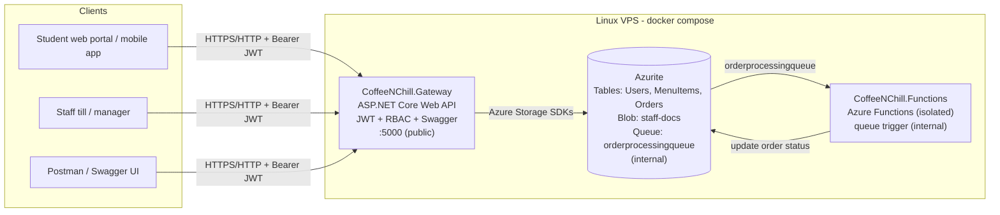

# CoffeeNChill - Cloud Development B (CLDV6212)

A cloud-enabled microservices system for the CoffeeNChill campus canteen, built with
**Azure Functions**, **Azure Storage** (Tables, Blobs, Queues), an **ASP.NET Core Web API
gateway** secured with **JWT**, **Docker**, and deployed to a **Linux VPS**.

> ### 🔗 Live deployment (Part 3)
> **Swagger UI:** http://20.216.12.104:5000/swagger
> **Health:** http://20.216.12.104:5000/health
>
> Hosted on an Azure Linux VM (Ubuntu 24.04, Standard_B2ats_v2, UAE North) running `docker compose` with the images from Docker Hub.
>
> Public access may be disabled after the video recording, for security.

## Videos

| Part | YouTube |
|---|---|
| Part 1 | https://youtu.be/KHqFFDEhFDk |
| Part 2 | https://youtu.be/KHqFFDEhFDk ← *check: same link as Part 1* |
| Part 3 | *add your Part 3 video link here* |

---

## Architecture (Part 3)



- The **gateway** is the single public entry point. It talks to Azure Storage
  directly through the Azure SDKs (Tables, Blobs, Queues).
- The **Functions** app (Parts 1 & 2) processes the order queue in the background:
  Received → Preparing → Ready.
- **Azurite** emulates Azure Storage. Set `STORAGE_CONNECTION_STRING` to use a
  real Azure Storage account instead - no code changes.
- Only port **5000** is published. Azurite and the Functions host are reachable
  only on the Docker network.

---

## Part 3: Secure API Gateway, JWT & VPS Hosting

### Changelog (Part 2 → Part 3)

- **New `CoffeeNChill.Gateway` project** - ASP.NET Core 8 Web API that unifies the
  menu, document and order services behind one URL.
- **JWT authentication** - `POST /api/auth/register` and `POST /api/auth/login`.
  Tokens are HMAC-SHA256 signed and carry `ClaimTypes.Name`, `ClaimTypes.Email`
  and `ClaimTypes.Role`.
- **Users Azure Table** - PartitionKey = role (`Admin`/`Staff`/`Customer`), RowKey =
  email. Passwords are hashed with ASP.NET Core Identity's `PasswordHasher`
  (PBKDF2-HMAC-SHA512, salted, 100k iterations); plain passwords are never stored.
- **Role-based authorization** - public menu viewing and ordering; menu changes,
  staff documents and order management require `Admin` or `Staff`.
- **Swagger / OpenAPI** (Swashbuckle) with XML documentation for every endpoint,
  request body and response code, plus an **Authorize** button for Bearer tokens.
- **DTO architecture** - controllers accept/return DTOs only; Table entities and
  password hashes never leave the server.
- **Order status endpoint** - `PUT /api/orders/status` (Admin/Staff). The queue
  processor now stops at **Ready**; staff mark orders **Collected** (or Cancelled).
  Orders can only move forward, and ETag concurrency stops the processor and staff
  overwriting each other.
- **Server-side pricing** - order totals are calculated from live menu prices;
  unknown or unavailable items are rejected.
- **Security hardening** - login/register rate limiting (10/min per IP), file-type
  and 20 MB upload limits, path-traversal-safe file names, non-root gateway
  container, secrets only via `.env`, seed Admin created on first start.
- **Production `docker-compose.yml`** for the VPS (gateway + Functions + Azurite,
  persistent volume, health check), `docker-compose.local.yml` for local builds.
- **CI/CD pipeline** (`.github/workflows/deploy.yml`) - build, test, push
  version-tagged images to Docker Hub, SSH deploy to the VPS.
- **Unit & integration tests** (`CoffeeNChill.Gateway.Tests`, xUnit).
- **Postman collection v3** with Bearer `{{token}}` flows and automated tests for
  every role.
- Fixed the Part 1 table name typo (`Menultems` → `MenuItems`) so the gateway and
  Functions share one table.

### Roles and access

| Role | How it's created | Can do |
|---|---|---|
| *Anonymous* (student) | - | View menu, place order, track order |
| `Customer` | Anyone, via `POST /api/auth/register` | Same as anonymous (identity for future features) |
| `Staff` (barista) | An Admin registers them | Everything below except creating Staff/Admin users |
| `Admin` (canteen manager) | Seed account on first start, or another Admin | Everything, including registering Staff/Admin |

### Gateway endpoints

| Method | Route | Access |
|---|---|---|
| POST | `/api/auth/register` | Public (Customer). **Admin** token to create Staff/Admin |
| POST | `/api/auth/login` | Public → returns JWT |
| GET | `/api/auth/me` | Any logged-in user |
| GET | `/api/menu` | `[AllowAnonymous]` |
| GET | `/api/menu/category/{category}` | `[AllowAnonymous]` |
| GET | `/api/menu/{category}/{sku}` | `[AllowAnonymous]` |
| POST | `/api/menu` | `[Authorize(Roles = "Admin,Staff")]` |
| PUT | `/api/menu/{category}/{sku}` | `[Authorize(Roles = "Admin,Staff")]` |
| DELETE | `/api/menu/{category}/{sku}` | `[Authorize(Roles = "Admin,Staff")]` |
| POST | `/api/documents` (multipart, field `file`) | `[Authorize(Roles = "Admin,Staff")]` |
| GET | `/api/documents` | `[Authorize(Roles = "Admin,Staff")]` |
| GET | `/api/documents/{fileName}` | `[Authorize(Roles = "Admin,Staff")]` |
| DELETE | `/api/documents/{fileName}` | `[Authorize(Roles = "Admin,Staff")]` |
| POST | `/api/orders/queue` | `[AllowAnonymous]` |
| GET | `/api/orders/{orderDate}/{orderId}` | `[AllowAnonymous]` (order tracking) |
| GET | `/api/orders?status=Ready` | `[Authorize(Roles = "Admin,Staff")]` |
| PUT | `/api/orders/status` | `[Authorize(Roles = "Admin,Staff")]` |
| GET | `/health` | Public |

Responses: `401` = no/invalid/expired token, `403` = valid token but wrong role.

### Using a token

```http
POST /api/auth/login
{ "email": "manager@coffeenchill.ac.za", "password": "<seed admin password>" }

→ { "token": "eyJhbGciOi...", "tokenType": "Bearer", "expiresAtUtc": "...", "user": { ... } }

PUT /api/menu/Hot Drinks/COF-001
Authorization: Bearer eyJhbGciOi...
{ "price": 28.00 }
```

In Swagger: click **Authorize** and paste just the token value.

### Order lifecycle

1. `POST /api/orders/queue` (public) - the gateway validates SKUs, prices the order,
   saves it to the **Orders** table as **Received** and puts it on `orderprocessingqueue`.
2. The **queue-triggered Function** moves it to **Preparing**, then **Ready**
   (`ORDER_STEP_DELAY_SECONDS` apart).
3. A barista calls `PUT /api/orders/status` → **Collected** (or **Cancelled**).
   Orders never move backwards; Collected/Cancelled are final.

```json
POST /api/orders/queue
{
  "orderId": "ORD-2026-8801",
  "customerName": "Jane Smith",
  "selectedItemSKUs": ["COF-001", "PAS-104"],
  "orderTimestamp": "2026-10-12T10:15:00Z"
}
```

`orderId` and `orderTimestamp` are optional. Any `totalPrice` sent by the client is ignored.

---

## Running locally

### Option A - Docker (whole stack, built from source)

```bash
docker compose -f docker-compose.local.yml up --build
```

- Swagger: http://localhost:5000/swagger
- Seed Admin: `manager@coffeenchill.ac.za` / `Manager#2026!` (local only)
- Functions host: http://localhost:7071
- Azurite: 10000 (Blob), 10001 (Queue), 10002 (Table) - open with Azure Storage Explorer → *Local emulator*

### Option B - Visual Studio / dotnet CLI

Prerequisites: .NET 8 SDK, Azure Functions Core Tools v4, Azurite (Docker or `npm i -g azurite`).

```bash
# 1. Storage emulator
docker run -p 10000:10000 -p 10001:10001 -p 10002:10002 mcr.microsoft.com/azure-storage/azurite

# 2. Functions (queue processor) - http://localhost:7071
cd CoffeeNChill.Functions && func start

# 3. Gateway - http://localhost:5000/swagger (Development settings include a dev JWT key + seed Admin)
cd CoffeeNChill.Gateway && dotnet run

# 4. Tests
dotnet test
```

In Visual Studio, open `CoffeeNChill.sln`, set **multiple startup projects**
(Gateway + Functions) and press F5.

---

## Deployment (VPS)

Full step-by-step guide: **[docs/VPS-DEPLOYMENT.md](docs/VPS-DEPLOYMENT.md)**.

Short version, on an Ubuntu VPS with Docker installed:

```bash
mkdir ~/coffeenchill && cd ~/coffeenchill
# copy docker-compose.yml and .env.example here, then:
cp .env.example .env && nano .env      # set JWT_KEY and SEED_ADMIN_PASSWORD
docker compose pull && docker compose up -d
```

### Publishing images to Docker Hub

```bash
docker login
docker build -t glitchysheep78/coffeenchill-gateway:v3.0   ./CoffeeNChill.Gateway
docker build -t glitchysheep78/coffeenchill-functions:v3.0 ./CoffeeNChill.Functions
docker push glitchysheep78/coffeenchill-gateway:v3.0
docker push glitchysheep78/coffeenchill-functions:v3.0
```

### CI/CD (bonus)

`.github/workflows/deploy.yml` runs on every push to `main`:

1. Checkout and set up the .NET 8 SDK
2. Build the solution and run the tests
3. Build both Docker images
4. Push `3.0.<run>`, `v3.0` and `latest` tags to Docker Hub
5. SSH into the VPS and run `docker compose pull && docker compose up -d`

Repository secrets: `DOCKERHUB_USERNAME`, `DOCKERHUB_TOKEN`, `VPS_HOST`, `VPS_USER`,
`VPS_SSH_KEY` (optional `VPS_PORT`). Without the `VPS_*` secrets the deploy step is
skipped.

---

## Testing

### Automated tests

`CoffeeNChill.Gateway.Tests` (xUnit) - run with `dotnet test`:

- **Unit:** password hashing and login, Staff/Admin registration rules, JWT claims and
  signature validation, server-side order pricing, order status transitions, ETag
  concurrency.
- **Integration:** hosts the real gateway in memory (`WebApplicationFactory`) with
  in-memory storage and checks every protected endpoint returns 401 without a token,
  403 for a Customer and succeeds for Staff/Admin.

### Postman

- **Part 3:** `postman/CoffeeNChill-Part3.postman_collection.json` (36 requests with tests)
- VPS environment: `postman/CoffeeNChill-VPS.postman_environment.json`
- Part 1/2 collections: `postman/collections/` (Postman workspace format) and `docs/part1/`

Requests inherit **Bearer `{{token}}`** from the collection; the login requests store
the token automatically. Run the folders in order with the Collection Runner. For the
upload request, Postman needs file access to `postman/sample-docs/` (Settings →
Working directory), or re-select the file in the request.

With Newman:

```bash
npx newman run postman/CoffeeNChill-Part3.postman_collection.json \
  --env-var baseUrl=http://20.216.12.104:5000 --env-var adminPassword='<seed admin password>' \
  --working-dir postman
```

---

## Azure Storage layout

| Service | Name | Keys / notes |
|---|---|---|
| Table | `Users` | PK = Role, RK = email; `PasswordHash`, `FullName`, `CreatedDate` |
| Table | `MenuItems` | PK = Category, RK = SKU; `Name`, `Description`, `Price`, `IsAvailable` |
| Table | `Orders` | PK = order date (yyyy-MM-dd), RK = order ID; `Status`, `TotalPrice`, `UpdatedBy`… |
| Blob | `staff-docs` | Staff documents (Azurite doesn't emulate Azure Files, so Blob Storage is used) |
| Queue | `orderprocessingqueue` | Base64 JSON order messages |

Azurite ports: **Blob 10000, Queue 10001, Table 10002**.

---

## Project structure

```
├── CoffeeNChill.sln
├── CoffeeNChill.Gateway/            # Part 3 - ASP.NET Core Web API gateway
│   ├── Auth/Roles.cs
│   ├── Controllers/                 # Auth, Menu, Documents, Orders
│   ├── Data/                        # Repository interfaces + Azure Storage implementations
│   ├── Models/                      # Table entities, OrderStatus, Dtos/
│   ├── Options/                     # Storage, Jwt, SeedAdmin settings
│   ├── Services/                    # JwtTokenService, UserService, OrderService, StartupInitializer
│   ├── Program.cs                   # JWT, RBAC, Swagger, rate limiting, CORS
│   └── Dockerfile
├── CoffeeNChill.Gateway.Tests/      # xUnit unit + integration tests
├── CoffeeNChill.Functions/          # Parts 1 & 2 - Azure Functions (isolated worker)
│   ├── Functions/                   # MenuFunctions, DocumentFunctions, OrderFunctions (queue trigger)
│   ├── Models/  Services/
│   └── Dockerfile
├── docker-compose.yml               # Production (VPS) - pulls from Docker Hub
├── docker-compose.local.yml         # Local - builds from source
├── .env.example                     # VPS secrets template (copy to .env)
├── .github/workflows/deploy.yml     # CI/CD pipeline
├── postman/                         # Postman collections, environment, sample upload file
└── docs/VPS-DEPLOYMENT.md
```

## Docker Hub images

| Part | Images |
|---|---|
| Part 1 | `glitchysheep78/coffeenchill-functions:v1.0` |
| Part 2 | `glitchysheep78/coffeenchill-functions:v2.0` |
| Part 3 | `glitchysheep78/coffeenchill-gateway:v3.0`, `glitchysheep78/coffeenchill-functions:v3.0` (CI also pushes `3.0.<run>` and `latest`) |

---

## Part 2 summary: Queue Triggers & Docker Compose

- Azure Storage Queue `orderprocessingqueue` for asynchronous order processing
- Queue-triggered Azure Function that updates order status
- `Orders` Azure Table for order tracking
- `docker-compose.yml` orchestrating Azurite and the Functions host

## Part 1 summary: Azure Functions, Tables, Blobs & Docker Hub

- Menu management with Azure Table Storage (CRUD HTTP-trigger functions)
- Staff document upload/list/download with Blob Storage
- Functions containerised and published to Docker Hub

---

## Team contributions

### Part 1
- **Zaeem (ST10316317)**: Menu management functions and Table Storage integration
- **Jadeel (ST10339718)**: Document management functions and Blob Storage integration
- **Yash (ST10266783)**: Docker containerization and Docker Hub publishing
- **Zaeem (ST10316317)**: Postman collection and testing

### Part 2
- **Zaeem (ST10316317)**: Queue Storage service and order entity models
- **Jadeel (ST10339718)**: Queue-triggered function and order status transitions
- **Yash (ST10266783)**: Docker Compose orchestration and multi-container setup
- **Zaeem (ST10316317)**: Updated Postman collection with order queue tests

### Part 3
- **Zaeem (ST10316317)**: ASP.NET Core Web API gateway, DTO architecture and Swagger/OpenAPI documentation (XML comments, Bearer Authorize button)
- **Zaeem (ST10316317)**: Updated Postman collection with Bearer `{{token}}` flows and role-based tests (Admin, Staff, Customer, anonymous)
- **Jadeel (ST10339718)**: JWT authentication (register/login), Users Azure Table with PBKDF2 password hashing, and role-based authorization policies
- **Jadeel (ST10339718)**: Order status endpoint, lifecycle rules and ETag concurrency between the gateway and the queue processor
- **Yash (ST10266783)**: Linux VPS provisioning, Docker Engine/Compose setup and production deployment with docker-compose
- **Yash (ST10266783)**: GitHub Actions CI/CD pipeline (build, test, push version-tagged images to Docker Hub, SSH deploy) and unit/integration tests
